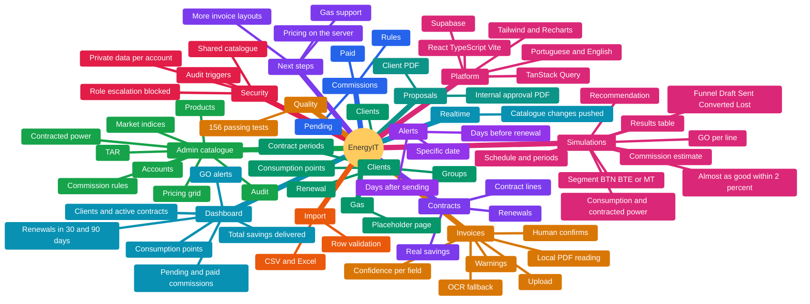
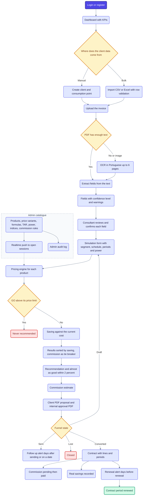

# Architecture

This document explains how EnergyIT is built and why. It is written from the code in this repository (`src/lib`, `supabase/migrations` and the tests).

## Map

Everything the app contains, by area.



## Flow from start to end

The main path through the app, with its branches. Blue is a step, yellow a decision, green a good end state, orange a state that needs attention, red a blocked or flagged case.



## 1. What the system does

A web ERP for an energy consultancy. A consultant uploads a client's electricity invoice, the app reads it, compares the client's current cost against a catalogue of supplier products, calculates estimated savings, generates a PDF proposal and computes the consultant's commission. It replaces an Excel pricing model with an auditable, database-backed workflow.

## 2. Big picture

```
 Browser (React SPA)
   |-- reads the invoice locally ........ pdf.js, Tesseract.js (OCR), no external API
   |-- pricing engine (mathjs) .......... runs in the browser on catalogue data
   |-- PDF proposals (jsPDF)
   |  supabase-js (user JWT)
   v
 Supabase
   |-- Auth ................ users, profiles, roles
   |-- Postgres ............ tables, RLS, audit triggers, views
   '-- Realtime ............ catalogue changes pushed to open sessions
```

Invoice data never leaves the browser for reading. The catalogue and calculation rules live in the database, the calculation itself runs in the client.

## 3. Invoice reading (`src/lib/invoiceReader.ts`, `invoiceExtraction.ts`)

1. **Read the file.** A PDF is read as native text first. If it has fewer than 100 characters, or more than 10% non-printable characters, it is treated as scanned: each page is rasterised and read with OCR in Portuguese (at most 6 pages). Images go straight to OCR. The libraries load only when needed.
2. **Extract fields.** Pure functions turn the page text into structured fields (CPE, dates, segment, schedule, periods, active energy, TAR, contracted power). Each field carries a confidence level (HIGH, MEDIUM, LOW) and the page where it was found. VAT, discounts, taxes and totals are deliberately ignored, so they are never mistaken for energy.
3. **Warn.** The extractor returns warnings for risky cases (several CPEs, estimated consumption, supplier change, low scan quality, unknown vocabulary).
4. **Human confirms.** Nothing fills the form on its own. The consultant reviews and confirms each field before it enters any calculation.

This design accepts that OCR and heuristics are imperfect, and puts a person at the point where an error would become money.

## 4. Pricing engine (`src/lib/pricingEngine.ts`, `formulaGrid.ts`)

- Supplier products, price variants, formulas, regulated tariffs (TAR) and market indices are **data in the database**, not code. Admins change them without a new release.
- Formulas are stored as expressions and evaluated safely with **mathjs** inside a scope built from the catalogue (market indices and the computed GO value of each product).
- For each product the engine computes energy cost per period, with and without TAR, and the saving against the current cost. Results are sorted by saving, with commission priority as a tie-breaker.
- **Recommendation:** products whose GO is above its price limit are never recommended, even if cheapest. Alternatives within a small margin (2%) of the best are shown as "almost as good".
- Commission is calculated from the commission rules and the client's annual consumption.

## 5. Data model (main tables)

- **People and business data:** `profiles`, `clients`, `grupos`, `pontos_consumo` (consumption points), `periodos_contrato`, `contracts`, `invoices`, `simulations`, `commissions`, `real_savings`, `alerts`, `documents`.
- **Catalogue (global):** `suppliers`, `products`, `product_energy_prices`, `product_price_variants`, `pricing_formulas`, `commission_rules`, `market_indices`, `tar_*` tables, `potencia_contratada_*`.
- **Audit:** `audit_log` (business data), `admin_audit_log` (catalogue and accounts).
- **Views for the dashboard:** revenue by month, commissions by status and supplier, funnel counts, upcoming renewals, total savings.

A simulation has a funnel state (draft, sent, converted, lost) and each consumption point has one active simulation.

## 6. Security model (two layers)

- **Business data is private per account.** Tables use RLS with `owner_id = auth.uid()` for all operations, with no admin bypass.
- **The catalogue is shared.** Every authenticated user can read it, and only admins can insert, update or delete (`public.is_admin()`).
- **Role escalation is blocked.** A trigger (`prevent_role_self_escalation`) stops users changing their own role.
- **Audit triggers** record changes to business tables and to the catalogue, with row-level history.
- The `search_path` of database functions is fixed, and a migration hardens it explicitly.
- **Session policy** in the client: "keep me signed in" lasts 30 days, otherwise the session ends when the browser closes. Storage access is wrapped in try/catch so the app works with storage blocked.

## 7. Realtime

The catalogue tables are published to Supabase Realtime, so an admin's price change reaches every open session immediately. The read-all RLS still decides who receives the broadcast.

## 8. Proposals and import

- `gerarPropostaPdf` builds the client-facing PDF proposal, and `gerarDocumentoAprovacaoInterna` builds an internal version with commissions (jsPDF).
- Clients and contracts can be imported from CSV or Excel. The parser and validators check each row before anything is saved.

## 9. Frontend

React, TypeScript and Vite, with TanStack Query for server state, react-router, Tailwind CSS 4, Recharts for the dashboard, and an i18n layer for Portuguese and English. Data access sits in hooks (`useClients`, `useSimulations`, `useCommissions`, and others).

## 10. Testing

156 passing tests with Vitest (4 more are skipped) cover the pricing engine, invoice extraction, invoice-to-form mapping, validators, PDF generation, simulation forms and contract lines. The engine and the extraction are pure functions, which is what makes them easy to test with fixtures.

## 11. How it was built

Developed with agentic AI coding (Claude Code), with sub-agents and agent skills in `.claude/` and `.agents/`. The domain rules came from the Excel model the system replaces, and the tests protect them.

## 12. Known limitations and next steps

- The pricing calculation runs in the client. Moving it to the server would make results reproducible server-side.
- Invoice extraction is heuristic and tuned to the invoice layouts it was developed against. New layouts may need new rules, which is why a human confirms each field.
- Gas is not implemented yet (there is a placeholder page).
